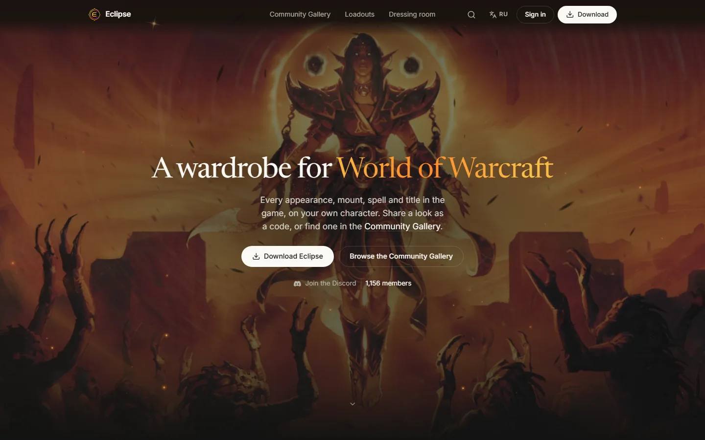
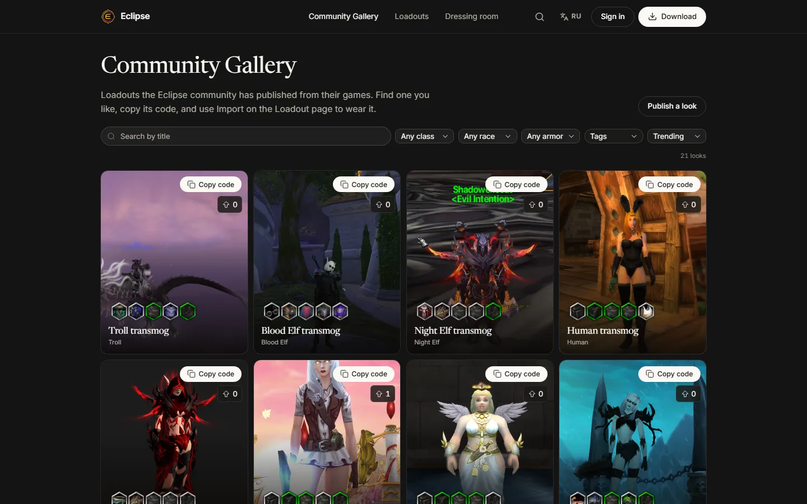
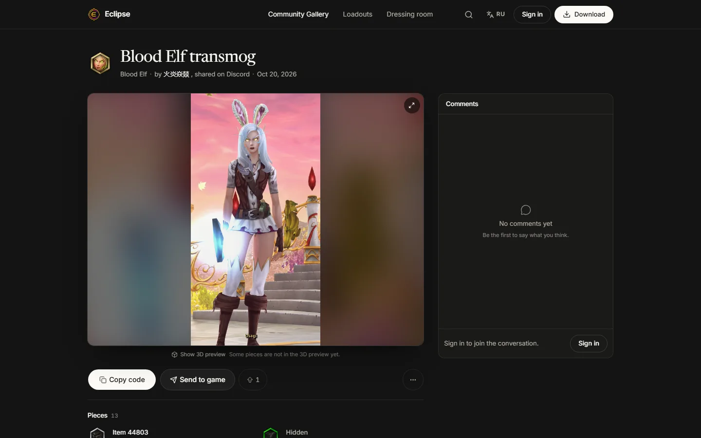
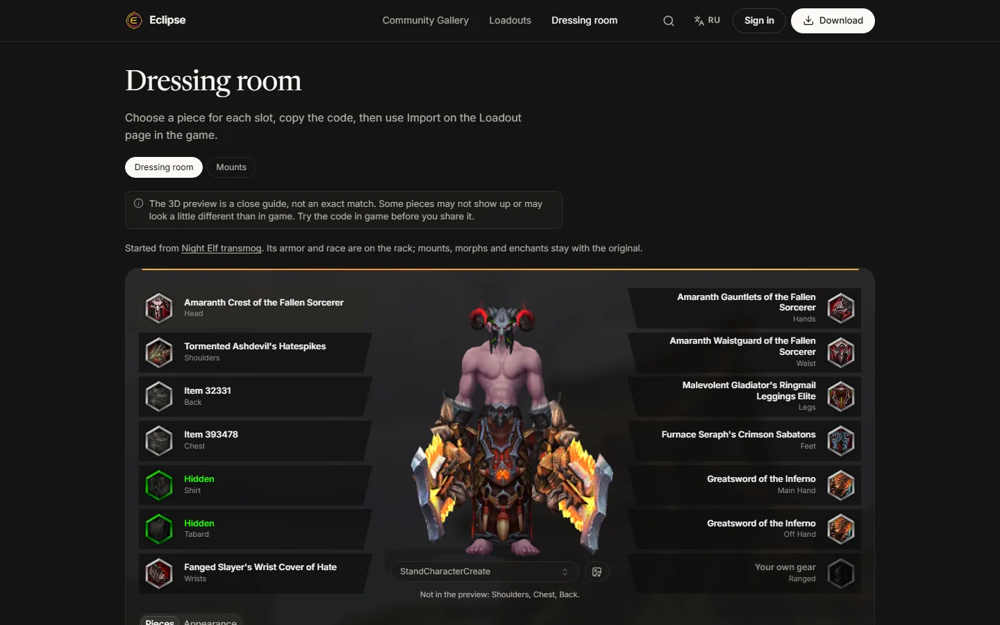
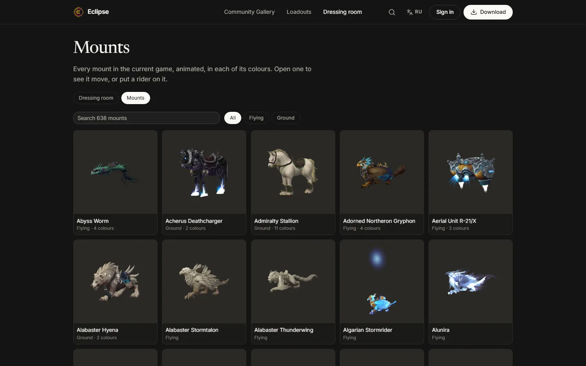
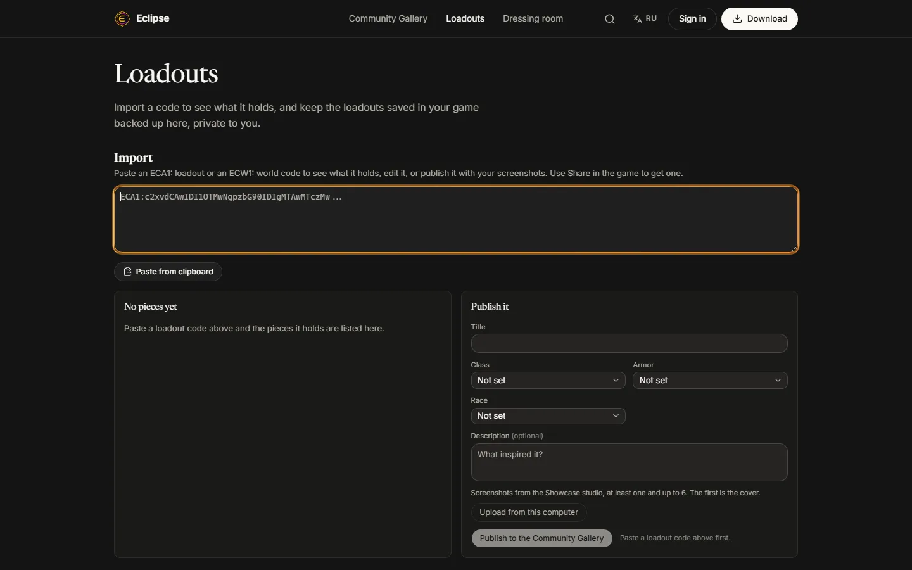
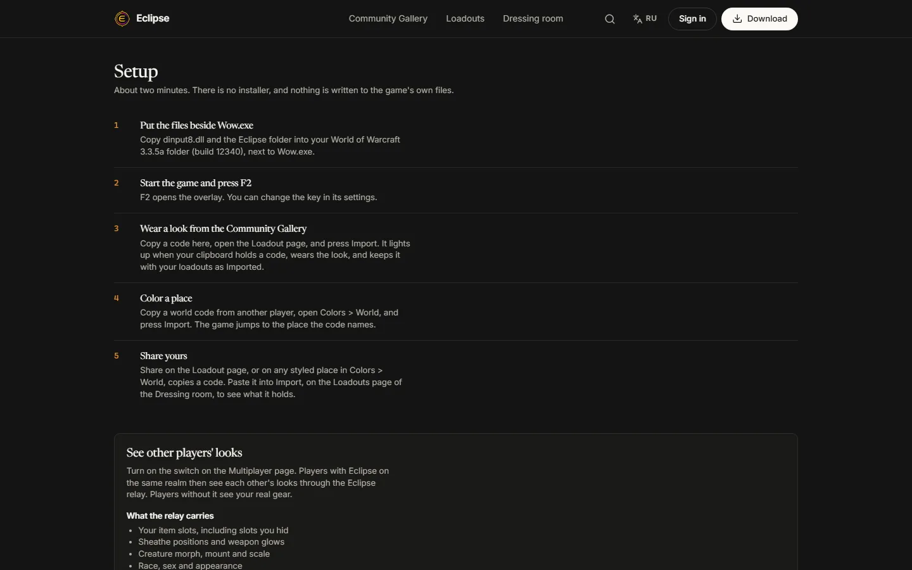
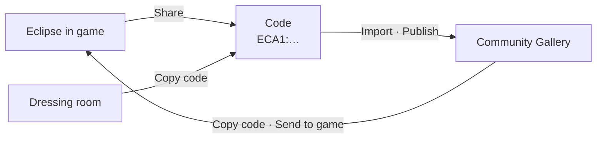

# Eclipse Web

**A wardrobe for World of Warcraft.** 
The official website for Eclipse, a free overlay for the World of Warcraft 3.3.5a client.

[Community Gallery](https://eclipsewow.vercel.app/community-gallery) · [Dressing room](https://eclipsewow.vercel.app/dressing-room) · [Mounts](https://eclipsewow.vercel.app/mounts) · [Setup guide](https://eclipsewow.vercel.app/guide)

 

> This is the official Eclipse website. Eclipse is an independent community project and is **not affiliated with, endorsed by, or sponsored by Blizzard Entertainment**. See [Legal](#legal-and-disclaimer).

## What is Eclipse?

Eclipse is an overlay for the 3.3.5a client. Press <kbd>F2</kbd> in game and every appearance, mount, spell and title in the game is available on your own character. Only you see the change, plus other Eclipse players who turn on Multiplayer.

A complete look fits in one short code, such as `ECA1:…`. This website is where those codes live: players publish their looks with screenshots from their game, browse what others have made, and dress a character in 3D before they try it in game.

## A look around

<table>
  <tr>
    <td width="50%" valign="top">
      
      
<b>Community Gallery</b> Looks the community has dressed, filtered by class, race, armor and tags, and sorted by what is trending.

    </td>
    <td width="50%" valign="top">
      
      
<b>A look</b> Screenshots from the player's game, every piece it wears, comments and upvotes. One click copies the code.

    </td>
  </tr>
  <tr>
    <td width="50%" valign="top">
      
      
<b>Dressing room</b> Build a look slot by slot on a 3D character, or start from any look in the Gallery, then copy its code.

    </td>
    <td width="50%" valign="top">
      
      
<b>Mounts</b> Every mount in the game, animated and in each of its colours. Open one to see it move, or put a rider on it.

    </td>
  </tr>
  <tr>
    <td width="50%" valign="top">
      
      
<b>Loadouts</b> Paste a code to see what it holds, edit it, or publish it to the Gallery with your screenshots.

    </td>
    <td width="50%" valign="top">
      
      
<b>Setup guide</b> From download to your first imported look in about two minutes. No installer, and nothing written to the game's own files.

    </td>
  </tr>
</table>

## Features

- **Community Gallery:** search and filter every published look, see each one's screenshots, pieces, comments and upvotes, and open its creator's page. The game's own item sets are listed too.
- **Screenshots first:** a look opens on the pictures from the player's game. The 3D figure loads only when someone asks for it with **Show 3D preview**.
- **Dressing room:** a 3D figure with race, sex and appearance options, dressed from the item catalogue.
- **Mounts:** browse every mount, filter flying and ground, and preview each colour.
- **Loadouts:** decode, edit and publish codes, and keep a private backup of the loadouts saved in a linked game, with **Send to game** on any look.
- **Discord:** a bot that decodes codes, searches the Gallery, adds a showcase post to it with a right-click, and asks a post's player for the code. A weekly Look of the Week post and Linked Roles reward the community's creators.
- **Two languages:** the site and the bot speak English and Russian.

## How a look travels

## Share codes

`src/lib/codec` encodes and decodes the `ECA1:` (loadout) and `ECW1:` (world look) code formats. Its tests replay codes that the game itself wrote and read back, so the site always writes exactly what the game expects.

## Built with

The 3D figures and mounts are drawn by the engine from [Eclipse-Viewer](https://github.com/Kirazul/Eclipse-Viewer), vendored in `packages/`. This repository hosts no game files.

## Team

Eclipse was founded by [Kirazul](https://github.com/Kirazul) and is developed together with [seolyam](https://github.com/seolyam). Come say hi, report a bug or share a look on [Discord](https://discord.gg/RvY5VjHgTA), and if Eclipse has earned a place in your game, you can [support it on Ko-fi](https://ko-fi.com/eclipsewow).

## Legal and disclaimer

**Not affiliated with Blizzard.** Eclipse and this website are the official home of an independent, free, non-commercial community project. They are not made, endorsed, sponsored or approved by Blizzard Entertainment, Inc. or Microsoft.

**Trademarks and game content.** World of Warcraft, Warcraft, Blizzard and Blizzard Entertainment are trademarks or registered trademarks of Blizzard Entertainment, Inc. in the U.S. and/or other countries. Game names, item names, icons, race, class and slot art, and other game imagery shown here are the property of Blizzard Entertainment, Inc. They appear only to identify game content for fans, and no ownership is claimed. They are not covered by any license for this repository and must not be reused commercially.

**Third-party art.** Rings and studio backdrops are from [Narcissus](https://www.curseforge.com/wow/addons/narcissus) by Peterodox, licensed [CC BY-NC-SA 4.0](https://creativecommons.org/licenses/by-nc-sa/4.0/) and used with the author's agreement. Credit must be kept wherever they appear, and use must stay non-commercial.

**Use at your own risk.** Eclipse modifies the game client, and Blizzard's [Terms of Use and EULA](https://www.blizzard.com/en-us/legal) restrict third-party software that modifies the client. It targets the 3.3.5a client. Blizzard has not approved it, and users are responsible for the rules of the realm or server they play on. This repository contains the website only, with no game client files.

**Non-commercial.** Nothing here sells game content or is gated behind payment. Voluntary support links only help cover running costs.

**Takedown requests.** Rights holders who want something changed or removed can open an issue, and it will be handled promptly.

**License.** No license has been granted yet. All rights in the original code are reserved by the author.
